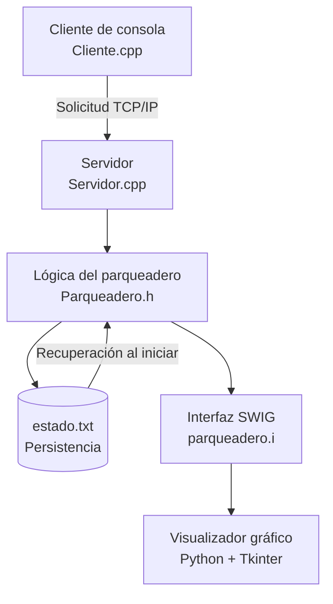

# Sistema de Gestión y Control de Parqueadero

Sistema de gestión y control automatizado de un parqueadero con capacidad para **40 celdas**, desarrollado en C++ y Python mediante una arquitectura cliente-servidor. El proyecto integra comunicación por sockets TCP/IP, persistencia de datos en archivos de texto y una interfaz gráfica interactiva para visualizar la ocupación del parqueadero en tiempo real.

## Tabla de contenidos

- [Descripción del proyecto](#descripción-del-proyecto)
- [Objetivos](#objetivos)
- [Características principales](#características-principales)
- [Tecnologías utilizadas](#tecnologías-utilizadas)
- [Arquitectura del sistema](#arquitectura-del-sistema)
- [Estructura del repositorio](#estructura-del-repositorio)
- [Requisitos previos](#requisitos-previos)
- [Instalación y compilación](#instalación-y-compilación)
- [Ejecución del sistema](#ejecución-del-sistema)
- [Funcionamiento](#funcionamiento)
- [Persistencia de datos](#persistencia-de-datos)
- [Solución de problemas](#solución-de-problemas)
- [Documentación adicional](#documentación-adicional)
- [Autores](#autores)

## Descripción del proyecto

El Sistema de Gestión y Control de Parqueadero permite administrar la ocupación de 40 celdas, registrando las placas de los vehículos y sus horas de entrada.

El sistema utiliza una arquitectura cliente-servidor. El servidor, desarrollado en C++, administra la lógica principal, procesa las solicitudes recibidas mediante sockets TCP/IP y mantiene la información del parqueadero en el archivo `estado.txt`.

Por su parte, el visualizador gráfico, desarrollado en Python con Tkinter, presenta el estado de las celdas mediante una interfaz interactiva. La comunicación entre C++ y Python se realiza mediante bindings generados con SWIG.

La información almacenada se recupera automáticamente al iniciar nuevamente el servidor, lo que permite conservar el estado del parqueadero entre ejecuciones.

## Objetivos

### Objetivo general

Desarrollar un sistema de gestión de parqueadero que integre la administración de celdas, la comunicación entre procesos, la visualización gráfica y la persistencia de información mediante herramientas de programación en C++ y Python.

### Objetivos específicos

- Administrar el estado de las 40 celdas del parqueadero.
- Registrar la placa de un vehículo y el número de la celda correspondiente.
- Implementar la comunicación cliente-servidor mediante sockets TCP/IP.
- Visualizar gráficamente la disponibilidad y ocupación de las celdas.
- Integrar C++ y Python mediante SWIG.
- Guardar y recuperar el estado del parqueadero utilizando un archivo de texto plano.

## Características principales

| Característica | Descripción |
|---|---|
| Capacidad | 40 celdas de parqueadero. |
| Gestión | Registro y procesamiento de entradas y salidas de vehículos. |
| Identificación | Registro de la placa asociada a una celda. |
| Comunicación | Sockets TCP/IP mediante Winsock2. |
| Puerto | 8080. |
| Interfaz gráfica | Visualizador interactivo desarrollado con Python y Tkinter. |
| Indicadores visuales | Verde para celdas libres y rosado/rojo para celdas ocupadas. |
| Integración | Bindings entre C++ y Python generados con SWIG. |
| Persistencia | Almacenamiento en `estado.txt`. |
| Recuperación | Restauración del estado guardado al iniciar el servidor. |

## Tecnologías utilizadas

| Tecnología | Función |
|---|---|
| C++ | Implementación del servidor y la lógica principal. |
| MinGW-w64 / g++ | Compilación del código C++. |
| Winsock2 | Comunicación de red mediante sockets en Windows. |
| Python 3 | Implementación del visualizador gráfico. |
| Tkinter | Construcción de la interfaz gráfica. |
| SWIG | Generación de bindings para integrar C++ y Python. |
| `setup.py` | Configuración de la compilación de la extensión de Python. |
| `estado.txt` | Persistencia y recuperación del estado del parqueadero. |
| Git y GitHub | Control de versiones y alojamiento del repositorio. |

## Arquitectura del sistema

El sistema está compuesto por tres elementos principales: el cliente de consola, el servidor en C++ y el visualizador gráfico en Python.



### Componentes

**1. Cliente (`Cliente.cpp`)**

Permite al usuario ingresar la placa del vehículo y el número de celda mediante un menú de consola. La información se transmite al servidor a través de una conexión TCP/IP.

**2. Servidor (`Servidor.cpp`)**

Gestiona las conexiones de red, recibe las solicitudes del cliente, procesa las operaciones sobre el parqueadero y actualiza la información persistente.

**3. Lógica del parqueadero (`Parqueadero.h`)**

Contiene la definición asociada a la lógica y la administración del estado de las celdas, según la implementación del proyecto.

**4. Interfaz de integración (`parqueadero.i`)**

Define la interfaz utilizada por SWIG para generar los bindings que permiten acceder desde Python a las funcionalidades expuestas por C++.

**5. Visualizador (`visualizador.py`)**

Presenta gráficamente las 40 celdas, mostrando su estado de ocupación, la placa asociada y la hora de entrada.

**6. Archivo de persistencia (`estado.txt`)**

Almacena el estado del parqueadero para permitir su recuperación cuando se reinicia el servidor.

## Estructura del repositorio

```text
parqueadero/
├── src/
│   ├── Servidor.cpp
│   ├── Cliente.cpp
│   ├── Parqueadero.h
│   └── parqueadero.i
├── python/
│   └── visualizador.py
├── setup.py
├── .gitignore
└── README.md
```

Los archivos generados durante la compilación, como ejecutables, extensiones binarias y carpetas de construcción, no forman parte de la estructura fuente principal.

> **Nota:** `estado.txt` es el archivo de persistencia utilizado por el sistema. Su ubicación debe coincidir con la ruta que utiliza la implementación al leerlo y escribirlo.

## Requisitos previos

Antes de compilar y ejecutar el proyecto, se requiere:

- Sistema operativo Windows.
- Python 3 instalado y disponible desde PowerShell.
- MinGW-w64 con `g++` disponible en el `PATH`.
- SWIG instalado y disponible desde la terminal.
- Herramientas de compilación compatibles con la extensión de Python que se va a generar.
- Git, si se desea clonar el repositorio.

Se recomienda comprobar las herramientas con los siguientes comandos:

```powershell
g++ --version
python --version
python -m pip --version
swig -version
```

## Instalación y compilación

### 1. Obtener el código fuente

Si el proyecto está alojado en GitHub, clona el repositorio y entra en su directorio:

```powershell
git clone <URL_DEL_REPOSITORIO>
cd <DIRECTORIO_DEL_REPOSITORIO>
```

Reemplaza los valores entre `< >` por la URL y el nombre reales del repositorio.

Si ya tienes el código fuente, abre PowerShell directamente en la raíz del proyecto.

### 2. Generar los bindings con SWIG

Ejecuta:

```powershell
swig -c++ -python src/parqueadero.i
```

Este comando genera los archivos de enlace necesarios para conectar la interfaz de C++ con Python.

Después, compila la extensión:

```powershell
python setup.py build_ext --inplace --compiler=mingw32
```

La compilación debe producir la extensión binaria que Python utilizará para acceder a las funciones de C++ expuestas mediante SWIG.

**Importante:** la extensión debe ser compatible con la versión y arquitectura de Python instaladas, así como con la configuración de MinGW-w64 utilizada.

### 3. Compilar el servidor

Desde la raíz del proyecto, ejecuta:

```powershell
g++ src/Servidor.cpp -o servidor.exe -lws2_32
```

La opción `-lws2_32` enlaza la biblioteca de Winsock2 requerida para la comunicación mediante sockets en Windows.

### 4. Compilar el cliente

Ejecuta:

```powershell
g++ src/Cliente.cpp -o cliente.exe -lws2_32
```

Al finalizar, deben estar disponibles los ejecutables del servidor y del cliente, junto con la extensión de Python generada mediante SWIG.

## Ejecución del sistema

El sistema se ejecuta utilizando **tres terminales de PowerShell independientes**, todas abiertas en la raíz del proyecto.

### Terminal 1: iniciar el servidor

```powershell
.\servidor.exe
```

El servidor debe iniciarse antes de utilizar el cliente, ya que recibe y procesa las solicitudes de conexión.

### Terminal 2: iniciar el visualizador gráfico

```powershell
python python/visualizador.py
```

Este comando abre la interfaz gráfica de Tkinter, que permite observar el estado de las celdas mediante la integración con C++.

### Terminal 3: iniciar el cliente

```powershell
.\cliente.exe
```

Desde el menú de consola, introduce la información solicitada, incluida la placa y el número de celda entre 1 y 40, y sigue las opciones disponibles para registrar las operaciones de entrada o salida.

### Orden recomendado de ejecución

1. Iniciar el servidor.
2. Abrir el visualizador gráfico.
3. Ejecutar el cliente para registrar las operaciones.

Para detener el sistema, finaliza los procesos desde sus respectivas terminales. Antes de cerrar el servidor, ten presente que el estado persistido se guarda en `estado.txt`.

## Funcionamiento

El flujo general de una operación es el siguiente:

1. **Entrada de datos:** el usuario introduce la placa y el número de celda mediante el cliente de consola.
2. **Transmisión:** el cliente empaqueta la información y la envía al servidor mediante sockets TCP/IP por el puerto 8080.
3. **Procesamiento:** el servidor recibe la solicitud y ejecuta la operación correspondiente sobre el estado del parqueadero.
4. **Persistencia:** el servidor actualiza el archivo `estado.txt`.
5. **Visualización:** el visualizador Python consulta los datos a través de la extensión generada con SWIG y actualiza la representación gráfica.
6. **Recuperación:** cuando el servidor vuelve a iniciarse, lee el archivo de persistencia para restaurar el estado almacenado.

### Representación de las celdas

| Color | Estado | Información mostrada |
|---|---|---|
| Verde | Libre | Indica que la celda está disponible. |
| Rojo | Ocupada | Muestra la placa y la hora de entrada del vehículo. |

La interfaz facilita la identificación visual de las celdas disponibles y ocupadas sin depender únicamente de la información de la consola.

## Persistencia de datos

El sistema utiliza el archivo `estado.txt` como mecanismo de persistencia.

Sus funciones principales son:

- Guardar el estado actualizado del parqueadero.
- Conservar la información entre ejecuciones del servidor.
- Recuperar la información almacenada durante el inicio del servidor.
- Mantener la representación del estado de las celdas después de un reinicio.

El archivo se sobrescribe cuando se actualiza el estado, de acuerdo con el comportamiento descrito para el sistema.

## Diagrama uml


